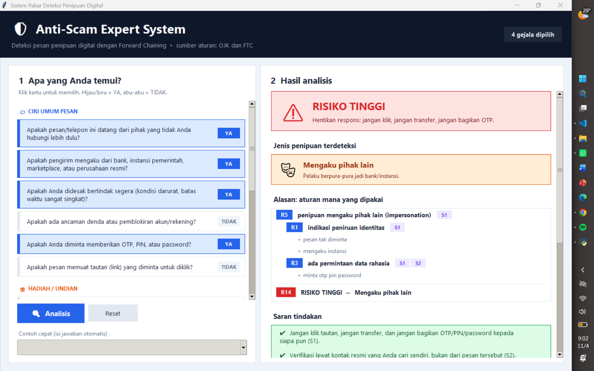
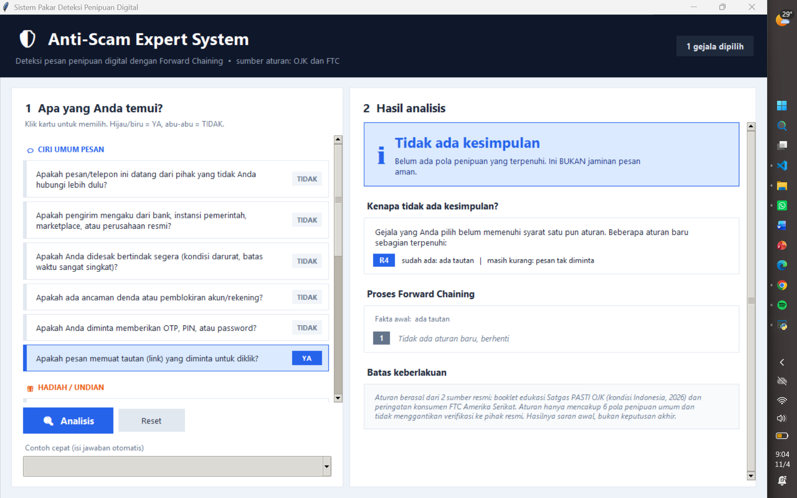
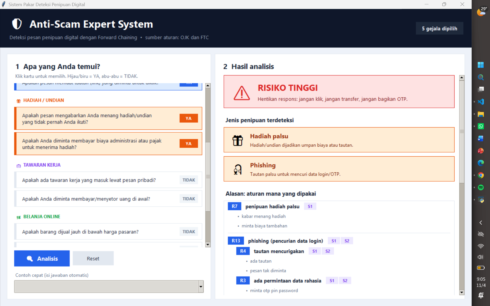

# Tugas 5 Kecerdasan Buatan: Sistem Pakar Deteksi Pesan Penipuan Digital

- **Nama:** Gusti Ayu Marsha Widyaswari
- **NIM:** F1D02410007

## Topik dan cara menjalankan

Topik: mengenali pesan/telepon penipuan digital (impersonation, hadiah palsu, lowongan kerja palsu, belanja online fiktif, investasi ilegal, dan phishing). Topik ini dipilih karena penipuan digital sedang marak di Indonesia: booklet Satgas PASTI OJK mencatat 608.167 laporan penipuan transaksi keuangan ke IASC sejak 22 November 2024 sampai 30 Juni 2026.

- Bahasa: Python 3.12, hanya pustaka standar (tanpa instalasi).
- Tampilan aplikasi (GUI, tkinter bawaan Python): `python Gui.py`
- Mode tanya-jawab di terminal: `python Main.py`
- Mode uji cepat (fakta "ya" langsung diberikan): `python Main.py --ya "ada_tautan,pesan_tak_diminta"`
- Uji otomatis 6 kasus: `python Test.py`

File: `Penipuan.json` (basis aturan), `Main.py` (mesin Forward Chaining dan mode terminal), `Gui.py` (tampilan aplikasi, memakai mesin di `Main.py`), `Test.py` (uji).

## Sumber

| Kode | Judul | Penerbit | URL | Diakses |
|---|---|---|---|---|
| S1 | Waspada Penipuan (Scam) Mengintai Kita, Ayo Lawan dan Hindari! (booklet) | Satgas PASTI / Otoritas Jasa Keuangan (OJK) | https://www.ojk.go.id/id/berita-dan-kegiatan/info-terkini/Documents/Pages/Booklet-Waspada-Penipuan-Scam-OJK/Booklet%20Waspada%20Penipuan%20Mengintai%20Kita%2c%20Ayo%20Lawan%20dan%20Hindari%21.pdf | 4 Nov 2026 |
| S2 | Protect yourself from phishing scams | Federal Trade Commission (FTC) Consumer Advice | https://consumer.ftc.gov/consumer-alerts/2025/04/protect-yourself-phishing-scams | 4 Nov 2026 |

Aturan adalah parafrasa dari kedua sumber.

## Tabel aturan

| Aturan | IF | THEN | Sumber |
|---|---|---|---|
| R1 | pesan tak diminta AND mengaku dari instansi/bank | indikasi peniruan identitas | S1 |
| R2 | desakan waktu OR ancaman denda/blokir | ada tekanan psikologis | S1 |
| R3 | diminta OTP/PIN/password | ada permintaan data rahasia | S1, S2 |
| R4 | ada tautan AND pesan tak diminta | tautan mencurigakan | S1, S2 |
| R5 | indikasi peniruan identitas AND ada permintaan data rahasia | penipuan mengaku pihak lain | S1 |
| R6 | indikasi peniruan identitas AND ada tekanan psikologis | penipuan mengaku pihak lain | S1 |
| R7 | kabar menang hadiah AND diminta biaya tambahan | penipuan hadiah palsu | S1 |
| R8 | kabar menang hadiah AND tautan mencurigakan | penipuan hadiah palsu | S1 |
| R9 | tawaran kerja lewat pesan pribadi AND diminta bayar di muka | penipuan lowongan kerja | S1 |
| R10 | tawaran kerja lewat pesan pribadi AND ada permintaan data rahasia | penipuan lowongan kerja | S1 |
| R11 | harga tak wajar AND transfer ke rekening pribadi | penipuan belanja online | S1 |
| R12 | untung tinggi tanpa risiko AND izin tak terbukti | penipuan investasi ilegal | S1 |
| R13 | tautan mencurigakan AND ada permintaan data rahasia | phishing (pencurian data login) | S1, S2 |
| R14 | salah satu dari 6 jenis penipuan di atas | RISIKO TINGGI: hentikan respons | S1, S2 |

Ada 14 aturan dan 7 kesimpulan. Rantai aturan: R1, R2, R3, R4 menghasilkan fakta antara yang dipakai R5 sampai R13, lalu hasilnya dipakai R14 (rantai sampai 3 tingkat).

## Metode: Forward Chaining

Dipilih karena semua data (ciri pesan) tersedia dari user di awal dan ada banyak kemungkinan kesimpulan, sehingga sulit menentukan satu hipotesis lebih dulu.

Langkah: memori diisi fakta yang dijawab "ya"; ulangi: cari aturan yang syaratnya terpenuhi (mode "dan" semua ada, "atau" salah satu cukup) dan hasilnya belum ada di memori; ambil aturan pertama, tambahkan hasilnya ke memori, catat asalnya; berhenti jika tidak ada aturan baru. Aturan yang hasilnya sudah ada tidak dijalankan lagi supaya program berhenti. Alasan dibuat dengan menelusuri mundur catatan asal tiap kesimpulan.

## Tampilan aplikasi

`gui.py` menampilkan 14 pertanyaan sebagai kartu yang dipilih dengan klik (YA/TIDAK), dikelompokkan per tema. Hasil ditampilkan dalam panel: banner risiko, jenis penipuan terdeteksi, alasan (aturan dan sumber yang dipakai), saran tindakan, proses Forward Chaining per siklus, dan batas keberlakuan. Menu "Contoh cepat" mengisi jawaban otomatis sesuai tiga kasus uji di bawah. Pada kasus tanpa kesimpulan, aplikasi menjelaskan aturan mana yang baru sebagian terpenuhi.

## Tiga kasus uji (dan tambahan)

Jalankan `python Gui.py` (atau `python Main.py`), isi jawaban sesuai tabel, lalu screenshot.

| # | Jawaban "ya" | Kesimpulan yang diharapkan | Screenshot |
|---|---|---|---|
| 1 | pesan tak diminta, mengaku instansi, desakan waktu, diminta OTP/PIN/password | impersonation, RISIKO TINGGI |  |
| 2 | hanya "ada tautan" | tidak ada kesimpulan (kasus negatif) |  |
| 3 | pesan tak diminta, menang hadiah, diminta biaya tambahan, ada tautan, diminta OTP/PIN/password | hadiah palsu, phishing, RISIKO TINGGI |  |

Kasus 2 tidak menghasilkan kesimpulan karena satu-satunya aturan yang memakai tautan (R4) juga mensyaratkan "pesan tak diminta". Kasus 4 sampai 6 (lowongan kerja, belanja online, investasi ilegal) dicek otomatis oleh `Test.py`.

## Batas keberlakuan

Pengetahuan dalam program ini berasal dari dua lembaga resmi: Satgas PASTI OJK (konteks Indonesia, edisi 2026) dan FTC Amerika Serikat (pencegahan phishing). Aturan hanya mencakup enam pola penipuan umum dan tidak menangkap modus baru, pesan yang tidak memiliki ciri-ciri tersebut, atau penipuan berbasis suara/gambar tiruan. Tidak ada kesimpulan bukan berarti pesan aman. Hasil program adalah saran awal, bukan keputusan akhir; jika ragu, hubungi pihak resmi lewat kontak yang Anda cari sendiri dan laporkan ke iasc.ojk.go.id atau Kontak OJK 157. Catatan ini juga ditampilkan oleh program.

## Penggunaan alat bantu AI

Claude digunakan untuk menyusun serta memparafrase draf aturan dari kedua sumber di atas, menulis kode awal, dan membuat tampilan aplikasi (`Gui.py`). Saya memeriksa dan memahami seluruh kode serta aturan.